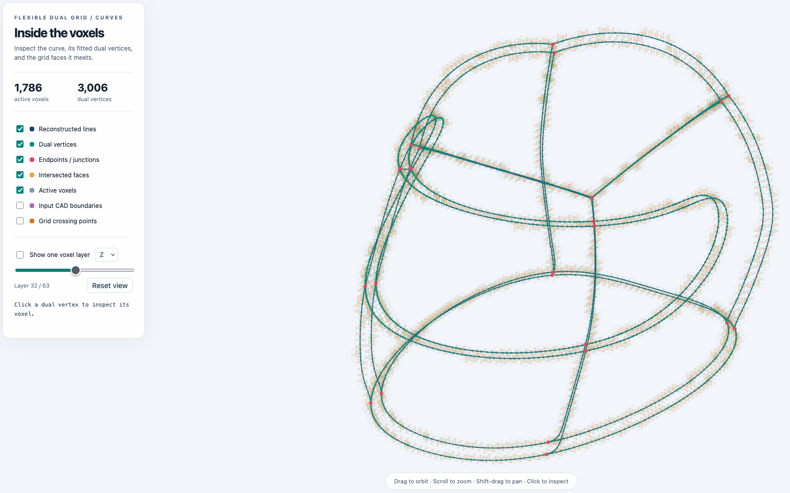
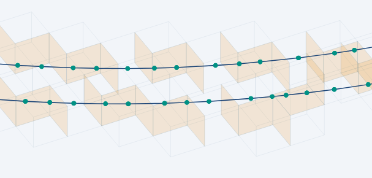

# O-Voxel for Line Segments

**O-Voxel** is a sparse, voxel-based native 3D representation designed for high-quality 3D generation and reconstruction. Originally proposed in [Trellis.2](https://github.com/microsoft/TRELLIS.2/), O-Voxel utilizes a **Flexible Dual Grid** formulation to robustly represent surfaces with arbitrary topology (including non-manifold and open surfaces).

This fork extends the [original library](https://github.com/microsoft/TRELLIS.2/tree/main/o-voxel), providing an efficient implementation for the instant bidirectional conversion between Line Graphs and O-Voxels on the CPU, along with tools for sparse voxel compression, serialization, and rendering. It extends the dual-grid idea to curves with a new line-distance QEF, face intersections, explicit connectivity, and endpoint/junction anchors.

<p float="left">
  
  
</p>

## Key Features

- **🧱 Flexible Dual Grid** for line segments.
- **⚡ Instant Bidirectional Conversion**: Rapid `Line Graph <-> O-Voxel` conversion.

## Installation

<!-- ### Line conversion and the helmet example (Linux/macOS/Windows, CPU) -->
### Tested on macOS

Run these commands from **this repository's root**:

```bash
conda env create -f environment-lines.yml
conda activate ovoxel-lines
BUILD_TARGET=cpu python -m pip install -e . --no-build-isolation --no-deps
python -m unittest discover -s tests -v
```

<!-- In PowerShell, set `$env:BUILD_TARGET = "cpu"` before the pip command. If the
environment already exists, activate it instead of creating it again. -->

The conversion itself needs only **NumPy**. The environment also installs the
**OpenCascade Python bindings without VTK** (`cadquery-ocp-novtk`) to read the
helmet's STEP boundary curves. No Torch, SciPy, plotting library, CUDA toolkit,
or C++ compiler is needed for this path. The HTML viewer is self-contained and
works offline.

There is **nothing to compile for the new line converter**: its traversal,
topology construction, QEF solve, and reconstruction are Python/NumPy. To build
a distributable CPU wheel:

```bash
BUILD_TARGET=cpu python -m pip wheel . --no-build-isolation --no-deps -w dist
```

For an environment that already has NumPy, and for line arrays rather than
STEP input, the editable install above suffices. CAD support is optional and
requires Python ≥3.11; install it with `python -m pip install '.[cad]'` if needed.

<!-- ### Original triangle-mesh backend (CUDA/ROCm)

The original mesh conversion/rendering still requires Torch and the compiled
`o_voxel._C` extension, plus the relevant mesh dependencies. On a machine with
a compatible GPU toolkit and C++17 compiler, install the appropriate Torch
build first, ensure `third_party/eigen/Eigen` exists, then run:

```bash
# Use the Torch build appropriate for your CUDA/ROCm toolkit.
python -m pip install torch setuptools wheel
BUILD_TARGET=cuda python -m pip install -e '.[mesh]' --no-build-isolation
# AMD alternative: BUILD_TARGET=rocm GPU_ARCHS=gfx942 python -m pip install -e '.[mesh]' --no-build-isolation
```

`BUILD_TARGET=auto` (default) builds the original extension if Torch and a
CUDA/ROCm toolkit are visible; otherwise it installs the CPU package. Use an
explicit target for reproducible builds. Package imports are lazy so the CPU
line API does not load optional mesh/GPU packages. The existing C++/CUDA mesh
sources have not been changed. Their GPU build was not tested on the development
machine (Apple Silicon, no CUDA/ROCm).

For the upstream mesh-only project, see
[TRELLIS.2](https://github.com/microsoft/TRELLIS.2). Its original installation is:

```bash
git clone -b main https://github.com/microsoft/TRELLIS.2.git --recursive
pip install TRELLIS.2/o_voxel --no-build-isolation
``` -->

## Curve O-Voxels: helmet example

```bash
conda activate ovoxel-lines
python examples/lines2ovox.py \
  --input assets/helmet/24380_528e79de.step \
  --resolution 64 --deflection 0.05 \
  --output outputs/helmet_lines

# Reconstruct using ONLY the saved O-Voxel archive:
python examples/ovox2lines.py \
  outputs/helmet_lines/line_ovoxels.npz \
  outputs/helmet_lines/reconstructed_again.obj

# Re-create a viewer from an archive:
python examples/visualize_line_ovox.py \
  outputs/helmet_lines/line_ovoxels.npz \
  --output outputs/helmet_lines/grid_only.html
```

Open `outputs/helmet_lines/viewer.html` in a browser. It shows reconstructed
lines, **dual vertices**, **intersected faces**, **active voxel boxes**, and
endpoint/junction anchors. Toggle the input CAD boundaries or crossing points
for comparison. Drag to rotate, scroll to zoom, Shift-drag to pan, and click a
dual vertex to inspect its voxel coordinates and local position. The slice
control isolates one X/Y/Z voxel layer so overlapping geometry is easier to see.

The default input is **the STEP B-rep**, not the tessellated `.obj`. OpenCascade
extracts each unique topological boundary edge once, evaluates its trimmed and
located curve, and samples it with
[`GCPnts_QuasiUniformDeflection`](https://occt3d.com/dev/doc/refman/html/class_g_c_pnts___quasi_uniform_deflection.html).
The supplied helmet contains **50 B-spline/NURBS edges and one straight edge**.
All 51 are included by default to retain complete boundaries. Add `--nurbs-only`
to select just the 50 B-spline edges. Shared CAD vertices retain shared indices;
independent bodies are not welded merely because positions coincide. Analytic
edges are also valid NURBS-representable curves, but the filter uses the actual
OpenCascade curve type. This is not a set of arbitrary surface isoparametric
curves or the triangle edges of the OBJ.

`--deflection` is a chord-error **target** in imported CAD units, normally mm;
the OCCT sampling heuristic is not a certified global error bound. It is separate
from voxel resolution. Smaller values give a finer polyline approximation of
the original NURBS. The original curve control points/weights are not recovered
by the inverse conversion, which outputs a line graph.

The example writes:

| File | Contents |
| --- | --- |
| `input_lines.npz`, `input_lines.obj` | Sampled B-rep boundaries; NPZ also records a CAD edge ID per segment |
| `line_ovoxels.npz` | Standalone curve O-Voxel representation, without the source line graph |
| `reconstructed_lines.npz`, `reconstructed_lines.obj` | Reconstructed world-space vertices and segment indices; OBJ uses `l` elements |
| `report.json` | Counts, timings, topology invariants, and sampled geometric errors |
| `viewer.html` | Offline interactive viewer with input/reconstruction overlays |

The same command accepts a `.npz` input with `vertices` `(V,3)` and integer
`segments` `(E,2)`. Use `--metrics-samples 0` to omit the all-pairs distance
estimates for large inputs; these diagnostics are much slower than conversion.

### Line conversion API

```python
import numpy as np
from o_voxel.convert import (
    LineDualGrid,
    lines_to_flexible_dual_grid,
    flexible_dual_grid_to_lines,
)

vertices = np.array([[0.1, 0.2, 0.3], [0.8, 0.2, 0.3], [0.8, 0.9, 0.3]])
segments = np.array([[0, 1], [1, 2]], dtype=np.int64)
grid = lines_to_flexible_dual_grid(
    vertices, segments,
    grid_size=32,                    # or voxel_size=0.05, but not both
    aabb=[[0, 0, 0], [1, 1, 1]],     # omitted: padded automatic bounds
    line_weight=1.0,
    boundary_weight=0.0,
    regularization_weight=1e-2,
)
grid.save("curve_ovoxels.npz")
restored = LineDualGrid.load("curve_ovoxels.npz")
out_vertices, out_segments = flexible_dual_grid_to_lines(restored)
```

The API accepts NumPy arrays, lists, or Torch tensors. Torch inputs are detached
and transferred to CPU; outputs are always NumPy arrays. It is not differentiable.
Shared **vertex indices**, not position proximity, define connectivity. Duplicate
undirected segments are removed, zero-length segments are rejected, and unused
vertices are ignored. Empty `(0,3)` / `(0,2)` arrays are supported with explicit
bounds. Inputs outside explicit bounds are rejected rather than silently clipped.
`grid_size` and `voxel_size` can be scalars or three-vectors; explicit bounds must
be integer multiples of `voxel_size`. Automatic bounds handle planar and straight
curves without zero-width dimensions.

### Deriving the curve QEF

A surface plane supplies one normal constraint. A 3D line supplies **two**
independent normal constraints and leaves displacement along its tangent free.
For a clipped segment with midpoint $p_i$, unit tangent $t_i$, and length $\ell_i$,
define the orthogonal projector

$$P_i = I - t_i t_i^\top.$$

Then $\|P_i(x-p_i)\|^2$ is squared distance to the segment's **supporting line**.
Using just $t_i t_i^\top$ would constrain the wrong directions. For each local
curve component, let $w_i=\ell_i/\sum_j\ell_j$, let $m=\sum_i w_i p_i$ be its
length-weighted mass point, and let $B$ contain its incident open endpoints and
junctions. Minimize within the cell:

$$E(x)=\alpha\sum_i w_i\|P_i(x-p_i)\|^2
 +\frac{\beta}{|B|}\sum_{b\in B}\|x-b\|^2
 +\lambda\|x-m\|^2,\qquad x\in\text{voxel}.$$

The boundary term is omitted if $B$ is empty. Defaults are $\alpha=1$,
$\beta=0$, $\lambda=0.01$. Anchors already preserve exact endpoints and
junctions, so a boundary attraction term is optional. Normalized length weights
make the QEF invariant to collinear subdivision and keep regularization strength
independent of sampling density. The mass regularizer resolves the tangent
nullspace of a straight line; multiple tangent directions locate corners.

The normal equations before applying the box constraint are:

$$A=\alpha\sum_i w_iP_i+(\lambda+\beta_B)I,\qquad
q=\alpha\sum_i w_iP_ip_i+\lambda m+\beta_B\bar b,$$

where $\beta_B=\beta$ when $B$ is nonempty and zero otherwise. The implementation
centers the solve at $m$ and uses physical coordinates scaled by the smallest
voxel side, preserving the Euclidean metric for anisotropic voxels. It first
tries the unconstrained minimizer and, if necessary, enumerates the 27 box active
sets. Simply clamping an unconstrained minimizer would not solve a coupled QEF.
With zero regularization, least squares chooses the closest-to-mass solution in
unconstrained null directions (relative singular-value cutoff `1e-12`).

### Parameters and connectivity

For surfaces, a crossed primal edge has four adjacent cells, whose dual vertices
form a quad. For curves, a generic crossed primal **face** has two adjacent cells,
whose dual vertices form a segment. Thus face incidence replaces edge incidence.
Three face bits and one dual per cell are insufficient for general line graphs:
two unrelated strands can share a voxel, a curve can terminate inside it, and a
small closed loop can lie entirely inside one cell.

`LineDualGrid` therefore stores this explicit extension:

| Parameter | Shape | Meaning |
| --- | --- | --- |
| `coords` | `(N,3)` integers | Unique active voxel indices |
| `dual_voxel_indices` | `(K,)` integers | Parent row in `coords` for each dual; `K` may exceed `N` |
| `dual_vertices` | `(K,3)` floats | Cell-local QEF solutions in `[0,1]^3` |
| `face_flags` | `(K,6)` booleans | Faces touched by each component: `−x,+x,−y,+y,−z,+z`, including tangencies and coplanar contacts |
| `anchor_vertices` | `(A,3)` floats | Exact world-space degree-one endpoints and degree-three-or-higher junctions |
| `edges` | `(M,2)` integers | Connectivity indexing `[world_dual_vertices; anchor_vertices]` |
| `link_points` | `(M,3)` floats | Original connection locations, for inspecting intersections |
| `link_axes` | `(M,3)` booleans | Axes crossed by dual-to-dual links; zero for anchor links |
| `aabb`, `grid_size` | `(2,3)`, `(3,)` | World bounds and cell counts |

World dual positions are
`aabb[0] + (coords[dual_voxel_indices] + dual_vertices) * voxel_size`.
The inverse gathers these positions, appends anchors, and returns the stored
links. It does **not** consult the input segments or STEP file. The face flags
are useful diagnostics but cannot replace the explicit links. NPZ serialization
is versioned and pickle-free; use `LineDualGrid.save/load`, not the original
mesh `o_voxel.io` or mesh `.vxz` packing convention.

Traversal splits segments exactly at grid planes, then contracts connected
degree-two chains within each cell. Disconnected components are kept separate;
open endpoints and junctions become anchors. Contractions that erase a complete
cycle or introduce parallel dual edges are refined to per-piece dual vertices.
This retains short segments, branches, and loops even below voxel resolution,
at the cost of variable storage per voxel.

Cells use half-open ownership. A line lying on an internal grid plane belongs
to the positive-side cell; the maximum AABB plane belongs to the last cell.
Simultaneous crossings of two/three planes produce a direct diagonal-cell link
with a multi-axis crossing mask, without artificial zero-length voxels. Events
within 32 double-precision epsilons in segment parameter are treated as one
crossing. Isolated tangencies do not activate a neighboring cell with no
positive-length curve portion. These conventions avoid duplicated coplanar lines.

This is a **lossy geometric approximation**: graph connectivity is retained, but
fine curvature, multiple corners in one contracted chain, and geometric separation
are not guaranteed. Fitted lines can intersect accidentally or coincide even
when their graph vertices remain distinct. Increase resolution to resolve these
features. It is not a fixed-width neural representation or a GPU-accelerated
replacement for the mesh backend; the new algorithm is a CPU reference with
work proportional to segment/grid-plane crossings, plus the local QEF solves.

### Verification on the supplied helmet

Tested on Apple Silicon with Python 3.13.13, NumPy 2.5.4, and
`cadquery-ocp-novtk` 8.0.1.1.0 in the new `ovoxel-lines` conda environment.
At resolution 64 and deflection 0.05, including all CAD boundary edges:

| Measurement | Result |
| --- | ---: |
| Sampled input segments | 2,213 |
| Active voxels | 1,786 |
| Dual vertices / exact junction anchors | 3,006 / 34 |
| Reconstructed line segments | 3,057 |
| Connected components, before / after | 5 / 5 |
| Independent cycles, before / after | 22 / 22 |
| Junctions of degree three, before / after | 34 / 34 |
| Sampled input → output maximum distance | 0.160 mm |
| Sampled output → input maximum distance | 0.136 mm |

The distance estimates use three samples per segment against the other
polyline graph; they are **not certified Hausdorff distances to the original
NURBS**. Exact timings and both directed mean/RMS/max errors are written to
`report.json` each run. Conversion took about 0.24 seconds before diagnostic
distance calculations on the development machine (timings vary).

The test suite covers straight lines, corners, constrained QEF minimization,
anisotropic grids, subdivision invariance, endpoint/junction retention, tiny
loops, independent coincident strands, grid-plane ownership, simultaneous
crossings, serialization, invalid inputs, random graph topology, CPU-only
imports, and the real helmet STEP round trip. CAD integration is skipped when
OpenCascade is not installed. A CPU wheel build and `pip check` were also run.

<!-- ## API Overview

### `o_voxel.convert`
Core algorithms for the conversion between meshes and O-Voxels.
*   `mesh_to_flexible_dual_grid`: Determines the active sparse voxels and solves the QEF to determine dual vertex positions within voxels based on mesh-voxel grid intersections.
*   `flexible_dual_grid_to_mesh`: Reconnects dual vertices to form a surface.
*   `textured_mesh_to_volumetric_attr`: Samples texture maps into voxel space.

### `o_voxel.io`
Handles sparse voxel file I/O operations.
*   **Formats**: `.npz` (NumPy), `.ply` (Point Cloud), `.vxz` (Custom compressed, recommended).
*   **Functions**: `read()`, `write()`.

### `o_voxel.serialize`
Utilities for spatial hashing and ordering.
*   `encode_seq` / `decode_seq`: Converts 3D coordinates to/from Morton codes (Z-order) or Hilbert curves for efficient storage and processing.

### `o_voxel.rasterize`
*   `VoxelRenderer`: A lightweight renderer for sparse voxel visualization during training.

### `o_voxel.postprocess`
*   `to_glb`: A comprehensive pipeline for mesh cleaning, remeshing, UV unwrapping, and texture baking. -->
